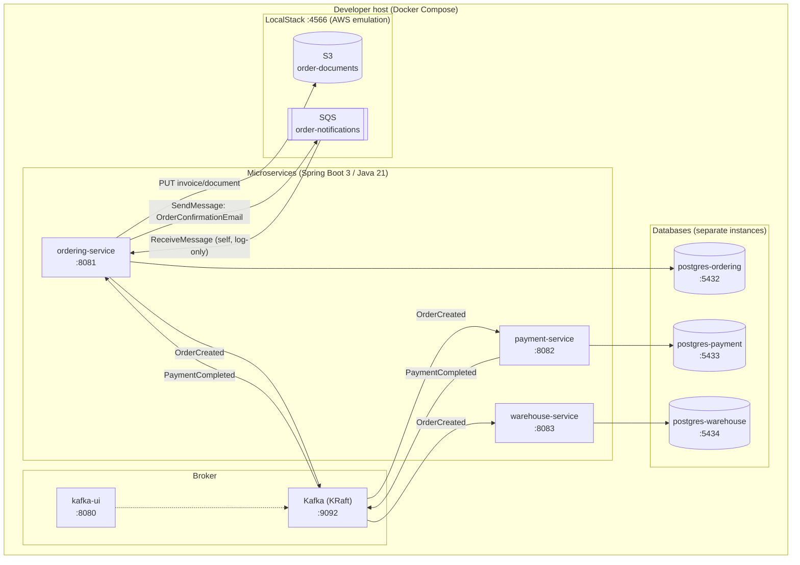
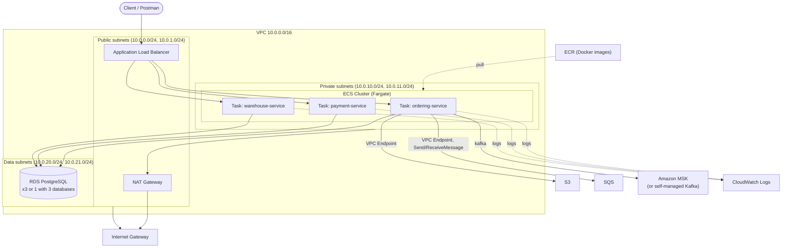

# PROJECT_PLAN.md — Roadmap (2-3 months)

> **Goal:** master Infrastructure, Terraform, Docker (writing Dockerfiles),
> AWS ECS/Fargate, and LocalStack from scratch, with your own hands.
>
> **Division of work:**
>
> **Ready-made (you don't need to deal with this):**
> - this plan + the directory structure,
> - `docker-compose.yml` — **local infrastructure** (Kafka KRaft, 3× PostgreSQL, LocalStack, kafka-ui). The application service blocks are in the file, but **commented out** — you'll uncomment them after writing their `Dockerfile`,
> - **minimal, REAL logic for 3 microservices** (Java/Spring/Kafka/S3, 5-8 classes per service). The code is deliberately trivial from a business standpoint — its only job is to prove that your infrastructure correctly wires together the database, Kafka, and the cloud.
>
> **Your job — the ENTIRE infrastructure, with me as the teacher (specs + checklists + review):**
> - the `Dockerfile` for each of the 3 services (Phase 1) — see `docs/GUIDE-dockerfile.md`,
> - all of Terraform: the `s3-bucket`, `sqs-queue`, `networking`, `ecr`, `ecs-service` modules + the `localstack` and `aws-prod` environments (Phases 2-3) — see `docs/GUIDE-terraform-localstack.md`,
> - wiring the services into `docker-compose.yml`, deploying to AWS Fargate.
>
> Rule: you get **what** needs to be built and **why** from me, not a ready-made answer. You write the file, I review it.

---

## 1. Architecture

### 1.1. Local environment (Docker Compose + LocalStack)



> **Kafka vs SQS — a deliberately split role (not a duplicate):** Kafka drives the saga between
> services (`OrderCreated`, `PaymentCompleted`) — these are events critical to the system's state.
> SQS handles a side effect outside the saga: after receiving `PaymentCompleted` from Kafka,
> `ordering-service` sends `OrderConfirmationEmail { orderId, email }` to SQS. A simple consumer
> (a polling method / `@SqsListener` in the same service) "sends the email" — for learning
> purposes a log line is enough, no real SMTP. The point: Kafka = domain events driving the flow,
> SQS = an asynchronous, failure-tolerant queue for a non-critical task (the email can be late or
> fail without affecting the order) — hence why `redrive_policy`/DLQ make sense in the
> `sqs-queue` Terraform module.

### 1.2. Target environment (AWS — Phase 3 goal)



---

## 2. Learning plan — 3 Phases

Legend: `[ ]` to do · `[~]` in progress · `[x]` done

### PHASE 1 — Local foundation: Docker + Compose + a live stack (~2-3 weeks)

**End result:** `docker compose up --build` starts 3 services + 3 databases + Kafka + LocalStack;
`POST /orders` triggers the chain Kafka → payment → invoice in S3 → warehouse reservation.

- [ ] Install and verify: `docker --version`, `docker compose version`, `terraform -version`, `aws --version` (CLI v2), `java -version` (21).
- [ ] Read `docker-compose.yml` line by line; write down what each section is responsible for.
- [ ] Start LocalStack on its own: `docker compose up localstack`; check `curl http://localhost:4566/_localstack/health`.
- [ ] Start just the databases; `psql` into each one (ports 5432/5433/5434); confirm data isolation.
- [ ] Start Kafka (KRaft); in `kafka-ui` (`:8080`) look at the list of topics.
- [ ] Read the `ordering-service` code (5 classes) — trace: request → JPA entity → `repository.save` → `kafka.send`.
- [ ] Read `payment-service` — pay attention to `@KafkaListener`, `AwsS3Config` (LocalStack endpoint, `forcePathStyle`), `InvoiceStorage` (`putObject`).
- [ ] Read `docs/GUIDE-dockerfile.md` in full (sections 1-4 + common mistakes).
- [ ] **Write `services/ordering-service/Dockerfile` FROM SCRATCH** following the guide. Build it: `docker build -t ordering-service:local ./services/ordering-service`. Check its size (`docker images`) and layers (`docker history`).
- [ ] Go through the checklist in section 7 of the guide. Fix whatever's off.
- [ ] **Write `services/payment-service/Dockerfile`** (`ARG APP_PORT=8082`, `LABEL`). Build it.
- [ ] **Write `services/warehouse-service/Dockerfile`** (`APP_PORT=8083`). This time from memory.
- [ ] Uncomment the `ordering-service` / `payment-service` / `warehouse-service` blocks in `docker-compose.yml`.
- [ ] `docker compose up --build`; wait until all services are `healthy`.
- [ ] Run the end-to-end test from the "Runbook" section in `README.md`: `POST /orders` → check payment's logs → a file in S3 (`aws s3 ls`) → `GET /stock` on warehouse.
- [ ] Look into the 3 databases via `psql`: the `orders`, `payments` (with `invoice_key`), `stock_items` tables.
- [ ] **(optional)** add a validation / new field to `ordering`; watch `ddl-auto: update` in action.
- [ ] **Checkpoint:** you can explain: image vs container, `build` vs `image`, `EXPOSE` vs `ports`, a named volume vs a bind mount, Compose's bridge network (DNS by service name), why `depends_on: condition: service_healthy`, why Kafka is `kafka:19092` inside a container but `localhost:9092` from the host.

### PHASE 2 — LocalStack + Terraform: IaC for the local cloud (~3-4 weeks)

**End result:** `terraform apply` in `environments/localstack` creates an S3 bucket and an SQS
queue in LocalStack; the services stop creating the bucket themselves and take its name from
`terraform output`.

- [ ] Read `docs/GUIDE-terraform-localstack.md` in full.
- [ ] **Write `environments/localstack/providers.tf`** — the `aws` provider for LocalStack (guide section 2: `endpoints`, `s3_use_path_style`, `skip_*`, explicit keys). This is the heart of the LocalStack vs AWS difference.
- [ ] **Write the `terraform/modules/s3-bucket/` module** (`main/variables/outputs/versions.tf` — guide section 3) with `force_destroy = true` — without it, `terraform destroy` will refuse to remove the bucket if it holds objects (and Phase 1 uploads invoices there). You'll reuse this same module in `aws-prod`, where the "cheap and disposable" rule applies even more.
- [ ] **Write `environments/localstack/main.tf`** — call the module, with `bucket_name` == `APP_S3_BUCKET` from compose (`aws-infra-order-documents-local`).
- [ ] `terraform init` → `fmt` → `validate` → `plan` → `apply`; verify with `aws --endpoint-url=http://localhost:4566 s3 ls`.
- [ ] `terraform destroy`; then `apply` again — understand idempotency and the state file (`terraform.tfstate`).
- [ ] In `payment-service`, set `APP_S3_AUTO_CREATE_BUCKET=false` (compose) — now only Terraform manages the bucket. Restart payment, confirm it's still uploading invoices.
- [ ] **Write the `terraform/modules/sqs-queue/` module** (a queue + optional DLQ + `redrive_policy` — guide section 4), following the same pattern as `s3-bucket`.
- [ ] In `environments/localstack/main.tf`, call both modules; export `outputs` (bucket name, queue URL).
- [ ] Inject the `outputs` into the services via environment variables in Compose (or `terraform output -json` → `.env`).
- [ ] In `ordering-service`, after receiving `PaymentCompleted` from Kafka, send an `OrderConfirmationEmail { orderId, email }` message to SQS (`SqsClient`, model it on `AwsS3Config`). Add a simple consumer in the same service (`@SqsListener` or polling `ReceiveMessage` in a loop/`@Scheduled`) that "sends the email" — for learning purposes `log.info(...)` is enough, no real SMTP. Rule: Kafka drives the saga between services (it must get through), SQS is an asynchronous, non-critical side effect (the email can fail/be late without affecting the order) — hence why DLQ/`redrive_policy` make sense here, not on Kafka.
- [ ] Learn `variables.tf` / `terraform.tfvars` / `-var-file`; separate environment values from module code.
- [ ] Introduce `for_each` — create 3 buckets (one per service) with a single module declaration.
- [ ] Set up a state backend: local first, then an S3 bucket in LocalStack as `backend "s3"`.
- [ ] Add `terraform fmt` + `terraform validate` to your own pre-commit checklist; optionally `tflint`.
- [ ] **Checkpoint:** you can explain: resource vs data source, a module (inputs/outputs), state and why it's sensitive, `plan` vs `apply`, `depends_on`, `lifecycle`.

### PHASE 3 — Real AWS: VPC + ECS/Fargate + ECR + Terraform prod (~4 weeks)

**End result of the phase (two stages):**
1. **3a — proving the pattern:** `ordering-service` runs on Fargate in a private subnet, behind an ALB, image from ECR, infrastructure in `environments/aws-prod`, all through Terraform. Here you learn the mechanics (networking, roles, ALB) on a single service, so mistakes cost less time.
2. **3b — the project's finale:** **the entire local stack recreated on AWS** — all 3 services on Fargate, RDS instead of 3× local Postgres, Amazon MSK instead of Compose's Kafka, S3 and SQS (already regional, so just a real endpoint instead of LocalStack) — and **the same end-to-end scenario as locally** (`POST /orders` → Kafka/MSK → payment → S3 invoice → warehouse reservation → SQS email) run against the ALB's public DNS. This is the real proof that you understand the whole picture, not just a single piece.

> **Phase 3 rule: cheap and fully disposable.** The entire `environments/aws-prod` is meant to
> live only for the duration of a session (`apply` → a few test runs → `destroy` after a few
> hours), not run non-stop. Concretely, that means:
> - **What costs money while it's running:** NAT Gateway (hourly), MSK (hourly/per-broker), RDS
>   (hourly), ALB (hourly) — **turn these off right after testing**. What's practically free at
>   rest: VPC, subnets, SGs, ECR (you pay only for image GBs), S3/SQS (billed for usage, not for
>   "being on").
> - **1 NAT Gateway, not 2** — for a one-off environment, HA on the NAT makes no sense; route
>   private subnets in both AZs to the same gateway. This saves the hourly fee for a second
>   gateway + a second Elastic IP.
> - **MSK as Serverless, not provisioned** — without this you pay for brokers 24/7 even while
>   you're asleep between test runs; Serverless bills for actual usage and disappears faster
>   after `destroy`.
> - **`force_destroy` / `force_delete` / `skip_final_snapshot` everywhere** (S3, ECR, RDS) —
>   otherwise `terraform destroy` will choke on a non-empty resource and leave you with
>   something that keeps costing money.
> - **Tag `Project = "aws-infra-learning"`** on every resource (`default_tags` in the provider) —
>   so you can spot anything `destroy` left behind at a glance in Cost Explorer / Resource
>   Groups.
> - Consider a simple `up.sh` / `down.sh` (or a `Makefile`) wrapping `apply`/`destroy`, so "a few
>   test runs, then tear it down" doesn't depend on you remembering at the end of a session.

#### 3a. A single service — Fargate/ALB/networking mechanics

- [ ] AWS account: an IAM user with MFA, `aws configure` (a profile), a **billing alarm** for a few USD.
- [ ] Set `default_tags { tags = { Project = "aws-infra-learning" } }` on the `aws` provider — every resource tagged from the first `apply`, making it easier to later find an "orphan" left by a failed `destroy`.
- [ ] Write the `terraform/modules/networking/` module: VPC, 2× public subnet, 2× private, IGW, **1× NAT Gateway** (not 2 — a one-off environment doesn't need NAT HA; route both private subnets to the same gateway), route tables.
- [ ] Write the `terraform/modules/ecr/` module: an image repository + `force_delete = true` (otherwise `destroy` won't remove a repo that still has images) + a `lifecycle_policy` (keep the last N tags).
- [ ] Build and push the image: `aws ecr get-login-password | docker login ...`, `docker build`, `docker push`.
- [ ] Write the `terraform/modules/ecs-service/` module: a cluster (or a shared one), a task definition (Fargate, CPU/RAM **256/512** — the cheapest pair for a short test, `containerDefinitions`, logs to CloudWatch), a service, a target group, a listener rule on the ALB.
- [ ] Split the roles: the **task execution role** (pulling from ECR, writing logs) vs the **task role** (the application's access to S3/SQS).
- [ ] Security Groups: ALB SG (443/80 from the internet) → ECS SG (the container port, only from the ALB SG) → RDS SG (5432, only from the ECS SG).
- [ ] Create an RDS PostgreSQL instance (`db.t4g.micro`, single-AZ, in the data subnets; `skip_final_snapshot = true`, `deletion_protection = false` — otherwise `destroy` will either stop or leave behind a snapshot that keeps costing money); connect `ordering-service` to it.
- [ ] Secrets: the database password in AWS Secrets Manager / SSM Parameter Store, injected into the task via `secrets` in the task definition.
- [ ] VPC Endpoints (Gateway for S3, Interface for SQS/ECR/logs) — traffic that never leaves the internet; compare the cost against NAT.
- [ ] `terraform apply` in `environments/aws-prod`; test it through the ALB's public DNS.
- [ ] Scale it: change `desired_count` from 1 to 2; watch the rolling deployment; set `deregistration_delay`.
- [ ] **`terraform destroy` at the end of every learning session** — cost control. After it: `aws resourcegroupstaggingapi get-resources --tag-filters Key=Project,Values=aws-infra-learning` — an empty list means nothing was left behind (Interface Endpoint ENIs sometimes detach with a delay and block subnet deletion on the first try — re-run `destroy` if that happens).
- [ ] **Checkpoint 3a:** you can draw from memory the path a packet takes: internet → ALB → task → RDS, with the SG and subnet at each hop.

#### 3b. Full stack migration and an end-to-end test on AWS (the project's finale)

- [ ] Extend to 3 services: `for_each` over a map of services calling the `ecs-service` module (`ordering`, `payment`, `warehouse`), each with its own target group/listener rule on the ALB.
- [ ] RDS: either 3 `db.t4g.micro` instances (one per service, mirroring the local `postgres-ordering/payment/warehouse`), or 1 instance with 3 databases — a deliberate choice, justify it on cost/isolation grounds.
- [ ] Write the `terraform/modules/msk/` module — use **`aws_msk_serverless_cluster`** (not provisioned): for a stack that runs a few hours and then gets `destroy`ed, provisioned pays for brokers 24/7 even between your test runs, while Serverless bills for usage and disappears faster. In the private subnets; a Security Group for the broker port (9098, IAM auth) allowing traffic only from the ECS SG.
- [ ] Change the Kafka config in `ordering/payment/warehouse-service` from `bootstrap-servers: kafka:19092` to the MSK broker endpoints (`terraform output`); enable SASL/IAM auth instead of plaintext.
- [ ] S3 and SQS: swap the LocalStack endpoint for the real regional one (or just remove the endpoint override — the SDK will default to the right region); confirm the `task role` from Phase 3a is sufficient (the same `s3:PutObject`, `sqs:SendMessage/ReceiveMessage` actions).
- [ ] VPC Endpoints (Gateway for S3, Interface for SQS/ECR/logs) — traffic that never leaves the internet; compare the cost against NAT. (MSK has no VPC Endpoint — the brokers sit directly in your subnets, hence the separate SG above.)
- [ ] Run **exactly the same end-to-end test as in Phase 1** (the "Runbook" from `README.md`), this time through the ALB's public DNS: `POST /orders` → payment's log → invoice in S3 (`aws s3 ls`, no `--endpoint-url`) → `GET /stock` on warehouse → the email-log in `ordering-service` (CloudWatch Logs) after `OrderConfirmationEmail` from SQS.
- [ ] Check in CloudWatch Logs that all 3 services are really talking to each other through MSK (no `TimeoutException`/`Disconnected` errors on startup).
- [ ] **`terraform destroy` the entire `environments/aws-prod`** once the test passes — MSK and RDS cost money non-stop, don't leave them running. MSK (even Serverless) is created and destroyed more slowly than the rest of the stack (on the order of several to a dozen-plus minutes) — factor that into your session's time budget, and don't create/destroy it between every single test run — only once per session: `apply` → several test passes on the same environment → `destroy` at the end.
- [ ] **Checkpoint 3b (the project's finale):** you can draw the full AWS architecture from memory (VPC, 3× Fargate, RDS, MSK, S3, SQS, ALB, SG) and explain what changed compared to the local version (LocalStack → real S3/SQS, Compose's Kafka → MSK, `psql` on the host → RDS in a data subnet), and what stayed the same (the application code, the `s3-bucket`/`sqs-queue` modules, the task role).

### Extensions (if there's time left)
- [ ] CI/CD: GitHub Actions — build the image, push to ECR, `terraform plan` on a PR, `apply` on merge.
- [ ] `terraform workspace` or per-environment directories (dev/stage/prod) — a deliberate choice with a rationale.
- [ ] Observability: CloudWatch Container Insights, a dashboard, an alarm on 5xx from the ALB.
- [ ] `terraform import` an existing resource; refactor a module without downtime.

---

## 3. Cheat sheet — networking and cloud concepts

### VPC (Virtual Private Cloud)
A private, isolated network in a single AWS region. You define it by an address range (CIDR),
e.g. `10.0.0.0/16`. Everything (subnets, ENIs, RDS, Fargate tasks) lives inside a VPC. By
default, resources in different VPCs can't see each other. Local analogy: the `bridge` network
Docker Compose creates.

### CIDR (Classless Inter-Domain Routing)
Notation for an IP range: `address/prefix`. The prefix is the number of network bits; the rest
are host bits.
- `/16` → mask `255.255.0.0` → ~65,536 addresses (`10.0.0.0`-`10.0.255.255`).
- `/24` → mask `255.255.255.0` → 256 addresses (AWS reserves 5 per subnet → 251 usable).
- `/28` → 16 addresses (11 usable) — typical for small subnets.
Rule: the VPC gets a large block (`/16`), and subnets carve smaller, **non-overlapping** pieces out of it.

### Subnet
A slice of the VPC's CIDR assigned to **a single Availability Zone (AZ)**. Types, per their route table:
- **Public** — has a route `0.0.0.0/0 → Internet Gateway`. Lives here: ALB, NAT Gateway.
- **Private** — route `0.0.0.0/0 → NAT Gateway` (outbound access exists, no inbound from the internet). Lives here: Fargate tasks, workers.
- **Isolated/data** — no route to the internet at all. Lives here: RDS.
For high availability: at least 2 subnets of the same type in 2 different AZs.

### Route Table / Internet Gateway / NAT Gateway
- **Route table** — rules of the form "route traffic to CIDR X toward target Y". Associated with subnets.
- **Internet Gateway (IGW)** — the VPC's gateway to the internet; two-way traffic for resources with a public IP.
- **NAT Gateway** — lets a private subnet **reach out** to the internet (pull an image, call an API), but blocks inbound connections initiated from outside. Billed hourly + per GB — a frequent source of surprise bills; the alternative is VPC Endpoints.

### Security Group (SG)
A **stateful** firewall at the ENI/resource level (not the subnet). Rules are "allow" only (no "deny").
Stateful = if you let traffic in, the response goes out automatically.
A rule's source can be another SG — the chaining pattern:
```
ALB-SG:  inbound 443 from 0.0.0.0/0
ECS-SG:  inbound 8081 only from ALB-SG
RDS-SG:  inbound 5432 only from ECS-SG
```
Contrast: **NACL** — stateless, at the subnet level, has "deny"; you usually leave the default one.

### ENI (Elastic Network Interface)
A virtual network card. Every Fargate task in `awsvpc` mode gets its own ENI with a private IP
in the subnet — that's why you attach an SG directly to the task.

### ECS: Cluster / Task Definition / Task / Service
- **Cluster** — a logical group in which tasks run (for Fargate it's mostly a namespace + settings).
- **Task Definition** — a versioned "recipe": image(s), CPU/RAM, ports, env vars, secrets, roles, log configuration. The equivalent of `docker run ...` plus a bit of Compose.
- **Task** — a single run according to a Task Definition (1+ containers sharing an ENI).
- **Service** — keeps `desired_count` tasks running, replaces them on deploy (rolling), registers them in the ALB's Target Group, restarts them after a failure.

### Fargate
An ECS launch type with no server (EC2) management. You pay for vCPU-seconds and GB-seconds per
task. Only specific CPU/RAM pairs are allowed (e.g. `256/512`, `512/1024`, `1024/2048`).

### Task Execution Role vs Task Role (the most common mix-up!)
- **Task Execution Role** — used by the **ECS agent**, before your application even starts: pulling the image from ECR, fetching secrets from SSM/Secrets Manager, shipping logs to CloudWatch. Base policy: `AmazonECSTaskExecutionRolePolicy`.
- **Task Role** — used by **your code** at runtime: `s3:PutObject`, `sqs:SendMessage`, etc. The AWS SDK inside the container automatically picks up these credentials from the metadata endpoint — no keys in the code.
Rule of thumb: pull/logs/secrets → execution role; AWS calls from the application → task role.

### ALB (Application Load Balancer) — Listener / Target Group
- **Listener** — listens on a port (80/443) + rules routing (by path/host) to a Target Group.
- **Target Group** — a set of targets (here: ECS tasks) + a health check (path, codes, thresholds). An unhealthy target drops out of rotation.

### ECR (Elastic Container Registry)
A private Docker image registry. Pushing requires a token login:
`aws ecr get-login-password | docker login --username AWS --password-stdin <acct>.dkr.ecr.<region>.amazonaws.com`.

### VPC Endpoint
A private entry point into AWS services without going out to the internet/NAT:
- **Gateway Endpoint** (S3, DynamoDB) — an entry in the route table, free.
- **Interface Endpoint** (SQS, ECR, CloudWatch Logs, Secrets Manager...) — an ENI in the subnet, billed hourly + per GB, but usually cheaper and more secure than NAT.

### LocalStack — mapping the concepts
| Production AWS | Locally |
|---|---|
| Region + endpoint `*.amazonaws.com` | a single endpoint `http://localhost:4566` |
| IAM credentials | anything (e.g. `test`/`test`), not checked |
| S3 virtual-hosted style | path style (`s3_use_path_style = true`) |
| IAM/VPC/SG genuinely enforced | in Community, mostly **not** enforced — don't learn permissions from this |

### Terraform — minimum concepts
- **provider** — a plugin for an API (e.g. `aws`); here configured for LocalStack (`endpoints`).
- **resource** — a resource managed by Terraform (creates/changes/destroys it).
- **data source** — reads an existing resource (read-only).
- **module** — a directory of `.tf` files, reusable, with inputs (`variables`) and outputs (`outputs`).
- **state** (`terraform.tfstate`) — a map of "code ↔ real resources". Sensitive (may contain secrets), kept in a backend (local / S3). Never edit it by hand.
- **plan / apply / destroy** — show the difference / apply it / remove it.
- Flow: `init` → `fmt` → `validate` → `plan` → `apply`.

---

## 4. Definition of done

- [ ] `docker compose up` = a full local environment with event-driven communication over Kafka.
- [ ] `terraform apply` (localstack) = S3 + SQS genuinely used by the services.
- [ ] `terraform apply` (aws-prod, stage 3a) = at least 1 service on Fargate behind an ALB, image from ECR, secrets from SSM/Secrets Manager, a correct chain of Security Groups.
- [ ] **`terraform apply` (aws-prod, stage 3b — finale) = the ENTIRE local stack recreated on AWS:** all 3 services on Fargate, RDS, Amazon MSK, S3, SQS — and **the same end-to-end test as locally** (Phase 1's Runbook) passes through the ALB's public DNS, with no LocalStack in the picture.
- [ ] Every infrastructure file written by your own hand (the patterns were only a starting point).
- [ ] You can draw both diagrams from section 1 from memory and explain every arrow.
